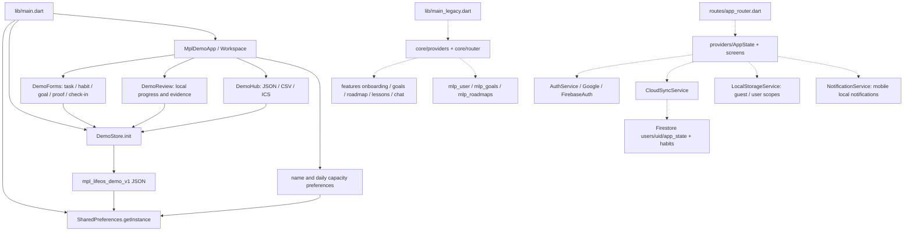
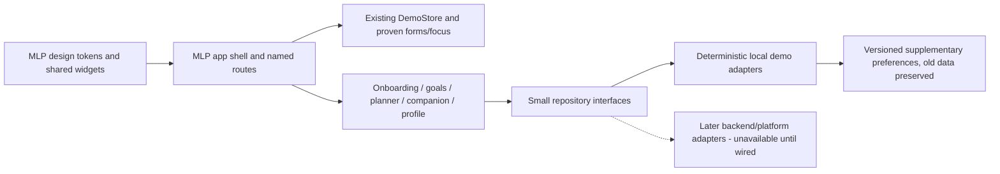

# MLP — mavjud arxitektura va boshqariladigan UI kengayishi

Tekshiruv: 2026-10-26. Bu diagrammada faqat topilgan real bog‘lanishlar bor; dotted yo‘llar faol `main.dart`dan ochilmaydigan eski qatlamni ko‘rsatadi.

Diagrammadagi Firestore real repository adapteri, **live cloud ulanishi tasdig‘i emas**. Faol main Firebase init qilmaydi. `main_legacy` Riverpod app bo‘lib, eski `AppRouter/AppState`ni o‘zi ishlatmaydi.

## Papka va xizmat majburiyatlari

- `lib/main.dart`: Flutter binding, local preferences va demo store bootstrap. Initial init xatosiga UI hozir yo‘q.
- `lib/demo/demo_app.dart`: faol theme, adaptive shell, Bugun/Reja/Fokus/sozlamalar, app lifecycle va aktiv taymer. Business qoidalari ko‘pi store’da; root katta, yangi modullar shu faylga tiqilmasin.
- `lib/demo/demo_store.dart`: mavjud local repository + domain service + ChangeNotifier vazifasini birga bajaradi. JSON schema, validation, atomic import, persisted aggregate va hisoblashlar shu yerda.
- `lib/demo/demo_forms.dart`: input validation, busy/save/error, tasdiq va controller disposal. Mavjud formalar yangi oqimda qayta ishlatiladi.
- `lib/demo/demo_review.dart`: source-state asosida review, portfel va eksport. `_WeekStats` tarixiy habit rule bilan moslanishi kerak.
- `lib/core/design/`, `core/widgets/`: oldingi navy/violet theme va reusable UI. Yangi markaziy MLP token/widget qatlamini shu yaxshi tajribadan kengaytirish mumkin.
- `lib/core/domain/`, `core/providers/`, `core/router/`, `features/`: Riverpod/go_router prototipi; yangi UI bilan parallel data yozdirilmasin.
- `lib/models/`, `providers/`, `routes/`, `screens/`, `services/`, `widgets/`: legacy habit/auth/cloud qatlam. Ishlaydigan helperlarni o‘chirmasdan saqlash; real adapterlar faqat aniq integration boundary orqali qayta ishlatiladi.
- `firestore.rules`: uid ownership source rule. Deploy va anonymous/cross-user emulator test isboti hali yo‘q.
- `android/`: Java17 compile/desugaring, notification receiverlar, conditional release signing. Joriy Gradle runtime loopback xatosi platform gate.
- `test/`: store invariants, import/export, forms/navigation/focus widget va render tekshiruvlari.

## Asosiy mavjud domenlar

| Model | Ma’no va muhim invariant |
|---|---|
| DemoGoal | Erkin title, numeric metric/target/current, deadline/category; current self-report, title emas sertifikat |
| DemoTask | Project, minutes, priority, dueDate, nullable goalId; proof/URL/completedAt; completion idempotent XP |
| DemoHabit | Target/unit/weekdays, per-day logs/reasons; historyRules tahrirdan oldingi kun ma’nosini saqlaydi |
| FocusRecord | Nullable taskId, real active seconds, timestamp; bu o‘qish natijasi emas |
| DailyCheckin | Kun, mood/energy 1–5, note; bitta kun yangilanishi qayta XP bermaydi |
| Legacy MlpGoal/MlpRoadmap | Yangi demo domenidan boshqa schema; tasodifan interchange qilinmasin |

## Mavjud oqimlar

1. Bootstrap → prefs → DemoStore.init: saved valid JSON → restore; key yo‘q → belgilangan sample; corrupt → raw data saqlanadi, xato yuzaga chiqadi.
2. Goal/task/habit form → validation → store mutation → notify → ketma-ket JSON write. Oddiy mutation uchun write failure memory rollback yo‘q; error/retry bor. Import esa validate → apply → persist → fail bo‘lsa oldingi holatga qaytadi.
3. Fokus: wall clock + anchorElapsed → pause’da real delta → persist FocusRecord → vazifa alohida proof orqali tugaydi. Process death’da pending timer tiklanmaydi.
4. Analytics: self-report tasks, habit logs, active seconds va manual goal metric. Independently assessed skill modeli hali yo‘q. Faollikning XP/darajasi malaka reytingi emas.
5. Eksport/import: manual JSON round-trip, CSV/ICS matn almashish, clipboard report. OAuth/sync emas; hech kimga avtomatik xabar ketmaydi.

## Saqlab qolish kerak bo‘lgan komponentlar

DemoStore validation/JSON contract va tests; Goal CRUD va link counters; DemoForms error/busy/controller lifecycle; focus wall-clock mexanizmi va uning 45 sekund testi; safe CSV/ICS escape/folding; destructive confirmation/import rollback; legacy uid storage va ownership rule; timezone notification adapterining mavjud platform boundarysi. Ekranlarni bir kechada o‘chirib, yangidan framework qurish talab qilinmaydi.

## Maqsadli UI o‘zgarishi

Yangi master prompt bo‘yicha nazoratli kengayish:

- Brend **MLP**, markaziy navy/violet/turquoise tokenlar; floating tablar Bugun/Maqsadlar/Fokus/Ustoz/Profil.
- Mavjud DemoStore bilan yangi schedule/assessment/chat/preferences/reward state orasida aniq boundary; yangi modullar eski kalitlarni o‘chirmaydi.
- 28 ekran named navigation orqali topiladi; hidden/dead CTA bo‘lmaydi. Integratsiya yo‘q bo‘lsa aniq unavailable/preview holati.
- Diagnostic deterministic test yoki self-assessment sifatida nomlanadi. AssessmentResult, reported Task proof va FocusRecord alohida ko‘rsatiladi.
- Voice listening/thinking/speaking — demo UI; real mikrofon/STT/TTS ruxsati olinmagan bo‘lsa “yozilyapti” degan soxta da’vo yo‘q.
- Weather/audio/partner reward faqat preview yoki licensed/local asset bo‘lsa real playback; yo‘q narsaga play/sotib olish success ko‘rsatilmaydi.
- Naviyatsiya/UI migratsiyasi bosqichma-bosqich; phase checkpointlarda faqat xavfsiz allowlist commit. Kalit/config/secrets commitga kiritilmaydi.

## Sinov strategiyasi

1. Har phase’da mos store/unit invariantlar; real disk rad etishi, JSON version/restore va xato holatlari uchun test.
2. Named route/back, form keyboard/validation/loading/error va end-to-end demo oqimi widget testlari.
3. Viewportlar: 320/360/390/430 kenglik, landscape, 1.0/1.5/2.0 text scale va keyboard inset. Reduced-motion va semantics/touch targetlar tekshiriladi.
4. Screenshot widget render alohida yorliq bilan; real Android screenshot deb berilmaydi. Font/ikon fixture cheklovi QA’da ko‘rsatiladi.
5. Auth/cloud yoqilishidan oldin Firebase emulator’da signed-out/owner/other-uid isolation va delete tests; hozir production Firebase’ga mutation yo‘q.
6. Android smoke gate: yangi APK o‘rnatish, cold/relaunch, guest → goal → task → reminder preference → focus → proof → progress, denied notification permission va process death. Qurilma yo‘q bo‘lsa gate **NOMA'LUM**, green deb belgilanmaydi.
7. Test logs va command exitlar `docs/evidence/`da; `flutter analyze` faqat static sifat isboti.
